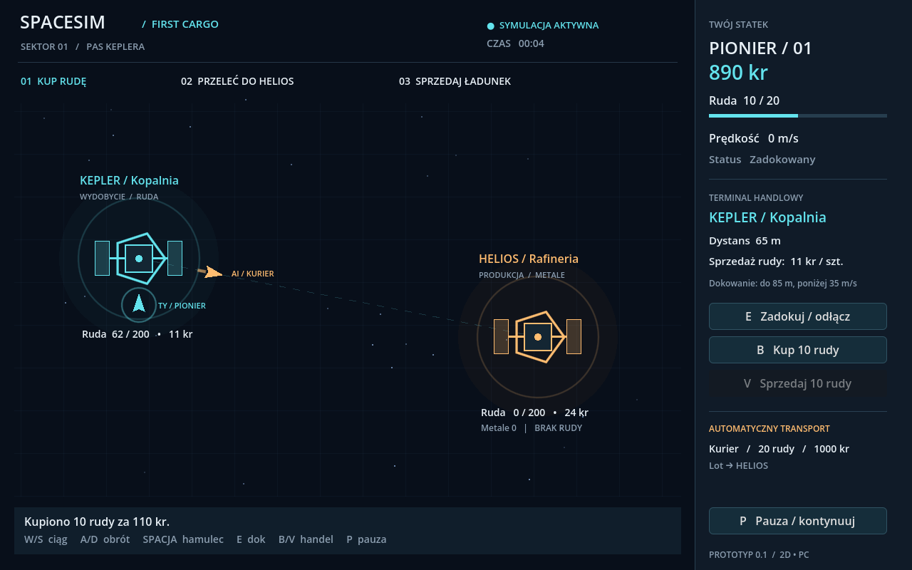

# SpaceSim — First Cargo

Pierwszy grywalny prototyp gry ekonomicznej w kosmosie: **2D, PC, Godot 4.6.3 .NET + C#**. Symulacja działa w osobnej bibliotece .NET 8, bez zależności od Godota.



## Co działa

- Pilotaż z góry: obrót, ciąg, bezwładność, hamowanie i ograniczony obszar sektora.
- Dokowanie przy stacji wymaga dystansu do 85 m i prędkości do 35 m/s.
- Kopalnia produkuje rudę, rafineria zużywa 2 jednostki rudy na 1 metal.
- Zakup i sprzedaż przenoszą rzeczywisty towar oraz kredyty; ceny zależą od zapasów.
- Transportowiec AI sam kupuje, przewozi i sprzedaje rudę. Pokazuje powód oczekiwania.
- HUD: stan ładowni, pieniądze, prędkość, ceny, zapasy stacji i praca AI. Pauza zatrzymuje cały świat.

To mały wycinek projektu, nie kompletna gra. Nie ma jeszcze walki, zapisu, rezerwacji dostaw, kolizji kadłubów, przełączania statków ani wielu sektorów. Stacje i statki mają grafikę proceduralną. Rafineria gromadzi metal i ma skończony budżet: po zapełnieniu magazynu lub wyczerpaniu pieniędzy handel zatrzymuje się zgodnie z regułami. Dalszy łańcuch produkcyjny i odbiorcy metalu są następnym etapem.

## Granie na Windows — portable, bez instalacji

Paczka: `dist/SpaceSim-0.1-win-x64-portable.zip` (Windows 10/11, Intel/AMD 64-bit).

1. Pobierz ZIP i wybierz **Wyodrębnij wszystkie**.
2. Otwórz wypakowany folder i uruchom **SpaceSim.exe**.
3. Pozostaw obok niego `SpaceSim.pck` oraz folder `data_SpaceSim.Game_windows_x86_64`.

Nie potrzeba administratora, instalatora, Godota ani .NET — biblioteki są dołączone. Nie uruchamiaj gry bezpośrednio z ZIP-a. Sterowanie i pierwszy kurs opisano niżej oraz w `CZYTAJ-MNIE.txt` w paczce. Postęp nie jest jeszcze zapisywany.

## Praca nad kodem na Windows

1. Zainstaluj **.NET SDK 8.0.426** oraz **Godot 4.6.3 .NET** (wersja standardowa nie obsługuje C#).
2. W katalogu repozytorium uruchom:

   ```powershell
   dotnet restore SpaceSim.sln --locked-mode
   dotnet build SpaceSim.sln --no-restore
   dotnet test SpaceSim.sln --no-build --no-restore
   ```

3. Zaimportuj `src/SpaceSim.Game/project.godot` w Godocie .NET i naciśnij **F6/F5**.

Pierwsze uruchomienie wymaga dostępu do NuGet. Windows jest planowaną pierwszą platformą wydania; bieżący prototyp zweryfikowano na Linux x86_64. Wyeksportowano również samodzielną paczkę Windows x64 z .NET. Sprawdzono kompletność bibliotek i integralność ZIP-a, ale pliku Windows EXE nie uruchamiano na Windows. Analogiczny eksport Linux przeszedł test uruchomienia bez zewnętrznego .NET.

## Linux / środowisko chmurowe

```bash
bash scripts/setup.sh       # pobiera narzędzia, sprawdza SHA-512, odtwarza zależności i buduje
bash scripts/check.sh       # testy rdzenia + import i smoke test w Godocie
bash scripts/run.sh         # gra; wymaga sesji graficznej
bash scripts/run.sh --editor
```

Instalator jest przeznaczony dla Linux x86_64; wymaga `curl`, `tar`, `unzip` i bibliotek systemowych obsługujących .NET/Godota. Instaluje lokalnie do ignorowanego `.tools/`, bez uprawnień administratora. Do bezpośrednich poleceń `dotnet` użyj wcześniej `source scripts/env.sh`. Skrypty korzystają z blokad wersji NuGet. W środowisku Codex sandbox może blokować systemowy mutex NuGet; komendy .NET wymagają wtedy uruchomienia z zatwierdzonym szerszym dostępem.

Bez ekranu można sprawdzić grę przez `bash scripts/run.sh --headless -- --smoke-test`. W zwykłym uruchomieniu headless gra działa bez obrazu aż do przerwania procesu.

## Pierwszy kurs

1. Zaczynasz obok kopalni Kepler. **E** — zadokuj, **B** — kup do 10 jednostek rudy.
2. **E** — odłącz dok. **A/D** obracają, **W** daje ciąg, **S** ciąg wsteczny; działają też strzałki.
3. Leć w prawo do rafinerii Helios. **Spacja** hamuje.
4. W obrębie okręgu dokowania wyhamuj i naciśnij **E**, następnie **V**, aby sprzedać do 10 rudy.
5. Obserwuj wzrost zapasu metalu oraz niezależnie pracującego Kuriera AI. **P** włącza i wyłącza pauzę. Handel i dokowanie mają także przyciski na panelu.

## Struktura

- `src/SpaceSim.Core` — autorytatywny stan świata, stały krok 60 Hz, pilotaż, gospodarka i automat transportowy.
- `src/SpaceSim.Game` — widok Godota, klawiatura i panel handlu; odczytuje stan tego samego świata.
- `tests/SpaceSim.Core.Tests` — testy transferu towarów i pieniędzy, limitów, dokowania, produkcji, AI i powtarzalności. Próba 2 godzin czasu symulacji sprawdza bilans zasobów.
- `docs/SpaceSim_Research_X4_i_plan.md` — oryginalny dokument badawczy użytkownika; propozycje dalszego zakresu.
- `docs/technology.md` — wybrany kierunek i granice pierwszego prototypu.

Symulacja jest jednowątkowa. Godot wywołuje jeden krok na `_PhysicsProcess` przy 60 Hz. Produkcja i decyzje handlowe mają rzadsze aktualizacje. To punkt wyjścia do pomiarów, bez obietnicy konkretnej maksymalnej liczby jednostek.

## Budowanie paczki portable

Po `bash scripts/setup.sh` uruchom `bash scripts/export-windows.sh` na Linux x86_64. Skrypt pobiera oficjalne szablony eksportu Godot 4.6.3 .NET (około 1,1 GiB, zachowywane w `.tools`), weryfikuje SHA-512, eksportuje Windows x64 z własnym runtime .NET i tworzy ZIP oraz sumę SHA-256 w ignorowanym `dist/`. W paczce znajdują się instrukcje, biblioteki i wymagane licencje. Do wykonania skryptu potrzebny jest też Python 3. Eksport nie jest podpisany cyfrowo.

Godot wskazuje rozwiązanie `SpaceSim.sln` w katalogu głównym przez `dotnet/project/solution_directory`, dzięki czemu kompilacja z edytora i eksport korzystają z tych samych projektów. Identyfikatory runtime `win-x64` i `linux-x64` są zapisane w projektach i lockfile'ach. Preset `Linux Validation` służy do sprawdzenia wyeksportowanej gry na maszynie budującej.
