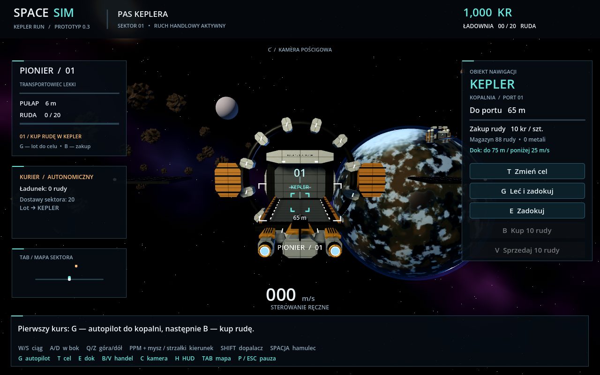
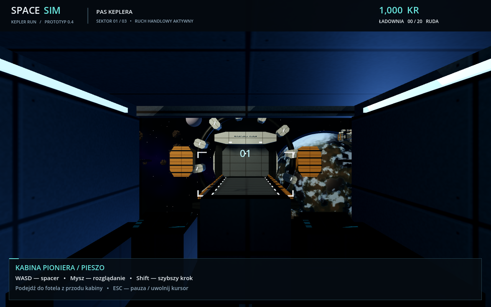
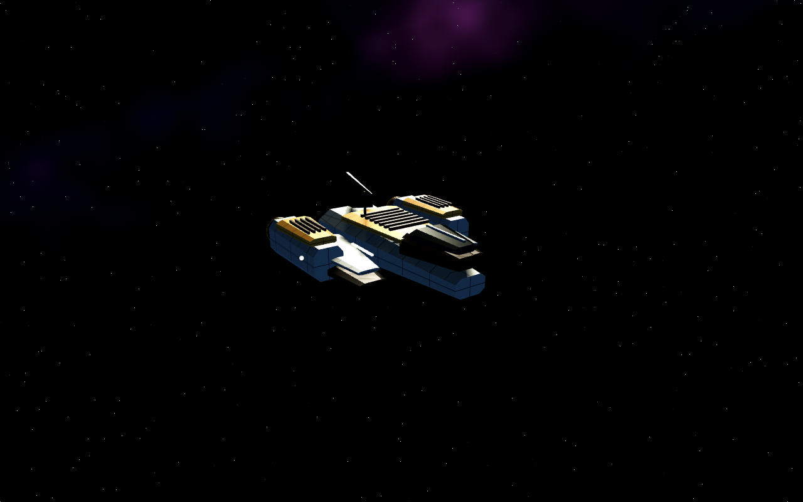
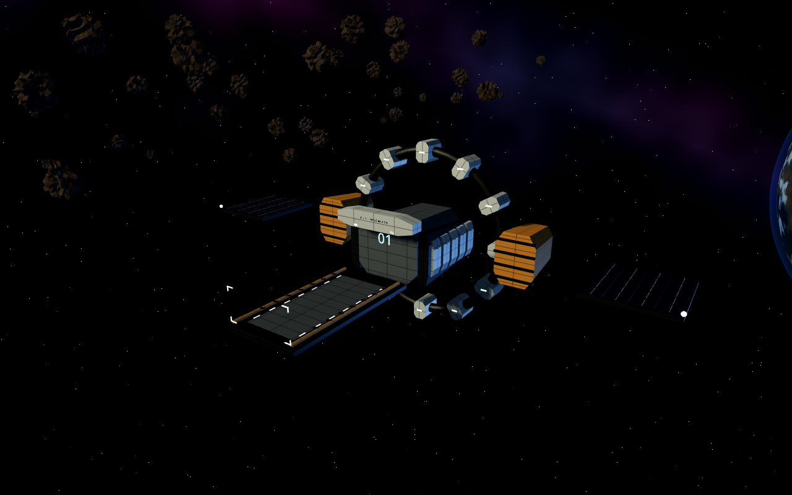
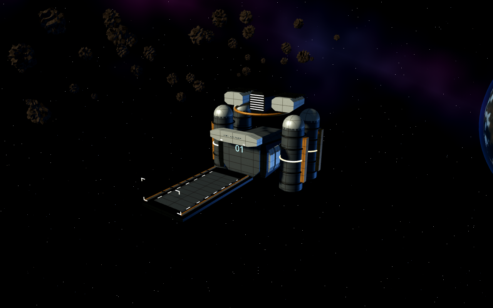

# SpaceSim — Kepler Run 3D

**Kosmiczny prototyp 3D na PC, Godot 4.6.3 .NET + C#.** Pilotuj statek, kup rudę w kopalni Kepler i dostarcz ją do rafinerii Helios. Transportowiec AI pracuje niezależnie, korzystając z tych samych magazynów i pieniędzy.



## Pobierz i graj — bez instalacji

**[Pobierz SpaceSim 0.4 3D portable — Windows 64-bit](https://github.com/misza344/SpaceSimv2/raw/refs/heads/main/dist/SpaceSim-0.4-3D-win-x64-portable.zip)**

1. Pobierz ZIP. Kliknij prawym przyciskiem → **Wyodrębnij wszystkie**.
2. Otwórz wypakowany folder i uruchom **SpaceSim.exe**.
3. Zachowaj obok EXE plik `SpaceSim.pck` i folder `data_SpaceSim.Game_windows_x86_64`.

Paczka zawiera Godota i .NET; nie wymaga ich instalacji ani uprawnień administratora. Gra działa offline. Wymaga Windows 10/11 x64 (Intel/AMD) i obsługi OpenGL 3.3. Nie uruchamiaj jej wewnątrz archiwum ZIP.

Wersja 0.1 w `dist/` jest archiwalnym prototypem 2D; 0.2 to pierwsza wersja 3D. Ostatnia paczka do pobrania powyżej to **0.4 3D**. Kod w tej gałęzi rozwija **0.5**, z zapisem gry. Nową paczkę generuje workflow „Verify and package SpaceSim” jako artefakt `SpaceSim-0.5-Windows`.

## Zapis i wczytywanie — 0.5

- **F5** zapisuje bieżący stan; **F9** wczytuje zapis i pauzuje grę. P / Esc wznawia lot.
- Obie czynności są dostępne również przyciskami w menu pauzy, podczas autopilota i spaceru po kabinie.
- Jeden slot zapisuje wszystkie trzy sektory, zapasy i kredyty, ładunek, produkcję, trasę i czas oczekiwania AI, trasę gracza oraz kamerę i pozycję w kabinie.
- Zapis jest **ręczny**. F9 zastępuje niezapisany postęp; gra nie wczytuje go automatycznie przy starcie.
- Plik jest w `user://saves/quicksave.json`; na Windows: `%APPDATA%\Godot\app_userdata\SpaceSim — Kepler Run 3D\saves\quicksave.json`.
- Poprzedni zapis zostaje w `quicksave.json.bak`. Odzyskanie ręczne: zamknij grę, zachowaj uszkodzony plik pod inną nazwą i skopiuj `.bak` jako `quicksave.json`.
- Niepełny plik, nieprawidłowe dane lub nieobsługiwana wersja są odrzucane przed podmianą świata. Nowy zapis jest najpierw zapisywany i opróżniany na dysk w pliku tymczasowym, potem zastępuje slot.

## Pierwszy kurs — najprościej

- Naciśnij **G**. Autopilot podejdzie do portu kopalni i zadokuje.
- Naciśnij **B**, aby kupić 10 rudy. Cel nawigacji automatycznie zmieni się na Helios.
- Ponownie **G** — statek odłączy się od doku, przeleci korytarzem nad sektorem i zadokuje przy rafinerii. Lot trwa kilkadziesiąt sekund.
- **V** — sprzedaj rudę. Kredyty wzrosną, a rafineria zacznie produkować metal.
- **TAB** otwiera mapę. Kliknięcie stacji wybiera cel. **C** zmienia kamerę.

Autopilot ma rzeczywisty czas podróży; nie teleportuje statku. Możesz w każdej chwili przejąć sterowanie klawiaturą lub przerwać go klawiszem G. Symulacja działa dalej podczas oglądania mapy.

## Eksploracja i kabina — 0.4

- **K**: autopilot do bramy. Po zatrzymaniu przy niej **J** przenosi do następnego sektora.
- Trasa: **Kepler → Vesper → Cinder → Kepler**. Każdy sektor ma dwie stacje,
  własne zapasy, trasy NPC, inne położenia obiektów i kolorystykę otoczenia.
- **F**: wstań z fotela po zatrzymaniu statku (spacja); autopilot musi być wyłączony.
  W kabinie WASD porusza pilotem, mysz obraca widok. Podejdź do fotela z przodu
  i naciśnij F, żeby znów sterować statkiem. Nie można przechodzić przez ściany.
- **M** przełącza sterowanie myszą bez trzymania PPM; **X** przełącza wspomaganie.
  Domyślnie puszczenie ciągu wyhamowuje statek; bez wspomagania zachowuje dryf.
- **Esc** uwalnia kursor i pauzuje. Utrata aktywności okna również pauzuje grę.

Stan sektorów pozostaje w pamięci podczas podróży; nieaktywne sektory są
wstrzymane. Wyjście z fotela obejmuje kabinę, bez spaceru po stacji i bez EVA.
Instrumenty 3D są dekoracyjne; dane lotu pokazuje HUD. W wersji 0.5 działa ręczny zapis na dysku.

## Sterowanie ręczne

| Klawisz | Działanie |
|---|---|
| W / S | Ciąg do przodu / wstecz |
| A / D | Przesunięcie w lewo / prawo |
| Q / Z | Wznoszenie / opadanie |
| Strzałki lub przytrzymany prawy przycisk myszy + ruch | Kierunek lotu: obrót i pochylenie |
| Shift | Dopalacz podczas przyspieszania |
| Spacja | Hamowanie |
| T | Zmień cel nawigacji |
| G | Autopilot do wybranego portu / przerwij |
| E | Dokowanie / odłączenie doku |
| B / V | Kup / sprzedaj do 10 rudy |
| C | Kamera zza statku / kamera pokładowa |
| Tab | Mapa sektora |
| P / Esc | Pauza / kontynuacja |

Dokowanie ręczne: podejdź do **świecącego portu**, nie do środka stacji; odległość do 75 m i prędkość poniżej 25 m/s. HUD pokazuje odległość do portu. Statek ma bezwładność i wspomagane hamowanie. F pozwala wstać po zatrzymaniu statku i chodzić po wymodelowanej kabinie.

## Co działa

- Rzeczywisty ruch w trzech osiach, ciąg, dopalacz, boczne/pionowe silniki i dwie kamery.
- Przestrzenne stacje, proceduralne statki i asteroidy, planeta z atmosferą, gwiazdy i oświetlenie.
- Kolizje statku gracza ze stacjami i asteroidami: zatrzymują lub odbijają ruch, bez zadawania obrażeń. Kolizje są liczone po odcinku ruchu, także przy dużej prędkości.
- Autopilot z korytarzami podejścia, wybór celu, mapa sektora i wskaźniki obiektów poza ekranem.
- Handel przenoszący rzeczywisty towar oraz kredyty; ceny zależne od zapasów.
- Kopalnia produkuje rudę, rafineria zamienia 2 rudy na metal, a Kurier AI sam wykonuje kursy. Przyczyny oczekiwania są widoczne.
- HUD, przyciski handlu, pauza i proste proceduralne dźwięki silników oraz poleceń.

To nadal prototyp: **nie ma walki, własnej floty ani budowy stacji**. Przed zamknięciem zapisz postęp klawiszem F5. Rafineria ma skończony budżet i magazyn metalu; docelowy dalszy obieg produkcji pozostaje do dodania. Autopilot obsługuje trzy przygotowane sektory, a nie dowolną proceduralną galaktykę. Planeta jest tłem, bez lądowania. Statki nie zderzają się ze sobą.



## Praca nad kodem

Windows: zainstaluj .NET SDK **8.0.426** i Godot **4.6.3 .NET**. W katalogu głównym:

```powershell
dotnet restore SpaceSim.sln --locked-mode
dotnet build SpaceSim.sln --no-restore
dotnet test SpaceSim.sln --no-build --no-restore
```

Zaimportuj `src/SpaceSim.Game/project.godot` w Godocie .NET i uruchom F5. Zwykły Godot bez .NET nie obsługuje C#.

Linux x86_64 / chmura:

```bash
bash scripts/setup.sh
bash scripts/check.sh
bash scripts/run.sh           # wymaga ekranu graficznego
bash scripts/run.sh --editor
bash scripts/run.sh --headless -- --smoke-test
bash scripts/export-windows.sh
```

Narzędzia trafiają do ignorowanego `.tools/`. Skrypty wymagają `curl`, `tar`, `unzip`, a eksport również Pythona 3. `source scripts/env.sh` aktywuje narzędzia dla bezpośrednich poleceń. W chmurowym sandboxie .NET może wymagać zatwierdzonego szerszego dostępu do systemowego mutexa NuGet.

Eksporter weryfikuje SHA-512 oficjalnych szablonów Godota, odtwarza zablokowane zależności, dołącza runtime .NET, instrukcję i licencje. Wynik: `dist/SpaceSim-0.5-3D-win-x64-portable.zip` oraz suma SHA-256. Wydanie nie jest podpisane cyfrowo. Pliki zależności edytora i konfiguracji ExportRelease mają osobne lockfile'y.

## Weryfikacja

Dotychczasowe 21 przypadków testowych obejmuje gospodarkę, dwie godziny symulacji, ruch pionowy, dokowanie 3D, kolizję przy dopalaczu, hamowanie i pełny kurs autopilota bez teleportacji. Test uruchomionej sceny Godota wykonuje zakup, przelot, sprzedaż, pracę AI oraz przełączenie kamer i mapy, chodzenie oraz obieg trzech sektorów. Szczegóły: [weryfikacja 0.4](docs/validation-0.4.md). Kontrole wykonujemy na Linux; eksport Windows sprawdzamy pod kątem kompletności i integralności, ale nie uruchamialiśmy EXE na Windows. Nie deklarujemy jeszcze wymagań wydajnościowych poza obsługą renderera — trzeba je zmierzyć na komputerze docelowym.

Weryfikacja zapisu 0.5 i ograniczenia tego środowiska: [validation-0.5.md](docs/validation-0.5.md).

## Struktura

- `src/SpaceSim.Core` — stan świata, Vector3, ruch, kolizje, trasy, gospodarka. Bez zależności od Godota.
- `src/SpaceSim.Game` — scena 3D, proceduralna geometria i shadery, kamera, dźwięk i HUD.
- `tests/SpaceSim.Core.Tests` — testy reguł i bilansu zasobów.
- `docs/SpaceSim_Research_X4_i_plan.md` — oryginalny research; zachowany bez zmian.
- `docs/technology.md` — obecna architektura i dalszy kierunek.


## Oprawa 0.3

Własne modele Pioniera, kontenerowca Atlas, kopalni Kepler i rafinerii Helios,
materiały z podziałem płyt, oznakowanie doków, rama kokpitu 3D oraz skały
z proceduralnym materiałem. H ukrywa interfejs, C przełącza kamerę.

[Kierunek wizualny i zakres researchu X4](docs/art-direction-x4.md).
[Modele GLB i odtwarzanie eksportu](assets/models/README.md).




